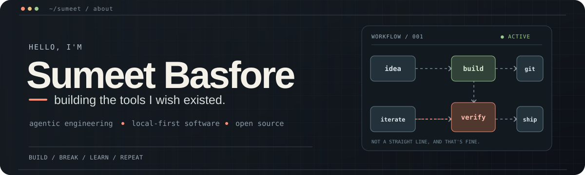
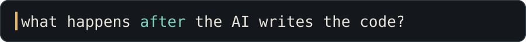

  

  <strong>Developer tools for working with AI coding agents.</strong> 
  Local-first · inspectable · built in public

  

I build developer tools, experiment with AI coding workflows, and occasionally disappear down a completely unrelated rabbit hole.

The question I keep coming back to:

  

Who checks it, understands it, and decides it's ready? I'm interested in software that makes those answers clearer, especially when it runs locally and stays under your control.

  

## Start here

| If you want to… | Go to |
| :-- | :-- |
| 🔭 See what I'm building | [Selected work](#selected-work) |
| 🔍 Look at the code | The repo link under each project |
| 🧪 Browse smaller experiments | [On the workbench](#on-the-workbench) |
| 📬 Get in touch | [Around the web](#around-the-web) |

  

## Selected work

### [01 — sraww](https://github.com/Sumeet-basfore/sraww) &nbsp;/&nbsp; draw, then ask why

A local, single-user Excalidraw-style whiteboard. Drawings are plain `.excalidraw` files on your disk. It adds an AI assistant that uses your existing Claude Pro or ChatGPT Plus subscriptions through their command-line tools, plus architecture maps that show how a project's folders depend on each other. The app holds no API keys and no accounts.

   

· [Explore the repo →](https://github.com/Sumeet-basfore/sraww)

  

### [02 — Traject](https://github.com/Sumeet-basfore/traject) &nbsp;/&nbsp; debug the agent, not just the code

A deterministic, local-first postmortem tool for coding-agent sessions. It connects agent transcripts, Git workspace state, and test output to show where progress went sideways. It uses no LLM to analyze the LLM, and no network calls.

  

· [Explore the repo →](https://github.com/Sumeet-basfore/traject)

  

### [03 — Relay](https://github.com/Sumeet-basfore/relay) &nbsp;/&nbsp; less trust by default

A local-first, zero-trust MCP security gateway and credential broker for AI agents. Tool calls are checked against [Cedar](https://www.cedarpolicy.com/) policies before they run (default deny), credentials are leased per action instead of sitting in the agent's environment, and every allowed or denied action produces a signed, verifiable receipt. Built around a simple rule: permission should be specific, not assumed.

   

· [Explore the repo →](https://github.com/Sumeet-basfore/relay)

  

### [04 — Ilvuno](https://github.com/Sumeet-basfore/ilvuno-code) &nbsp;/&nbsp; multiple agents, one place to review

An **in-progress** workspace for orchestrating coding agents, examining their changes, and integrating independently produced work. The ambition is a more manageable, verifiable multi-agent workflow.

The project is in the planning stage. The repository currently holds planning and architecture documents, and the code is still being added.

 

· [Explore the repo →](https://github.com/Sumeet-basfore/ilvuno-code)

  

## On the workbench

Smaller projects and experiments, still evolving.

| Project | Stack | What I'm exploring |
| :-- | :-- | :-- |
| [Forge](https://github.com/Sumeet-basfore/forge) |  | A local-first CLI for solo engineering workflows: reusable skills, rules, and project templates for agent-assisted work. |
| [Dylani](https://github.com/Sumeet-basfore/Dylani) |  | A local-first AI studio for prompt-to-UI prototyping, with editable design tokens and React source export. |
| [Sonicity](https://github.com/Sumeet-basfore/Sonicity) |  | Audio and transcription experiments. |

  

## Tech I work with

           

  

## A few things I believe

- **Show the evidence.** A green demo isn't the same as verified behavior.
- **Keep the user in control.** Local-first isn't always possible, but it's worth asking why not.
- **Ship the experiment.** Then find out what was wrong with the idea.

  

## Around the web

  
  
  

Most of this work is evolving in public. Some repositories are early experiments, not finished products.
